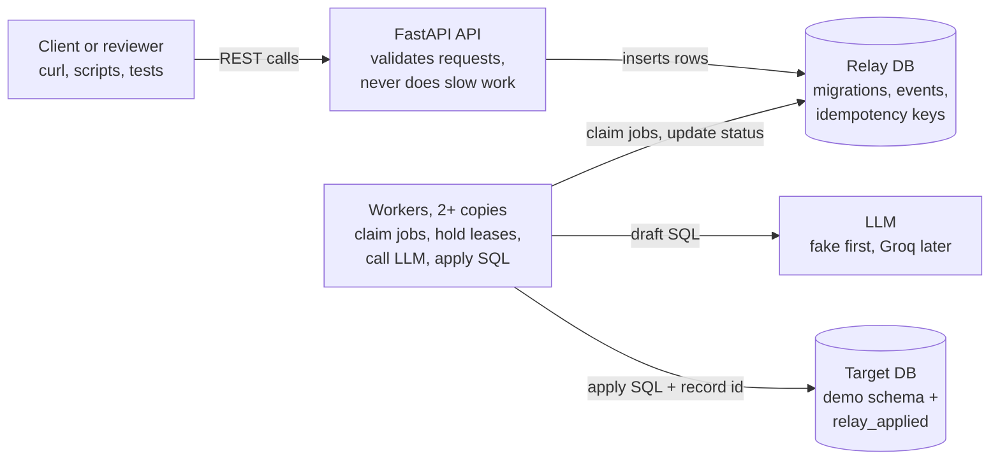
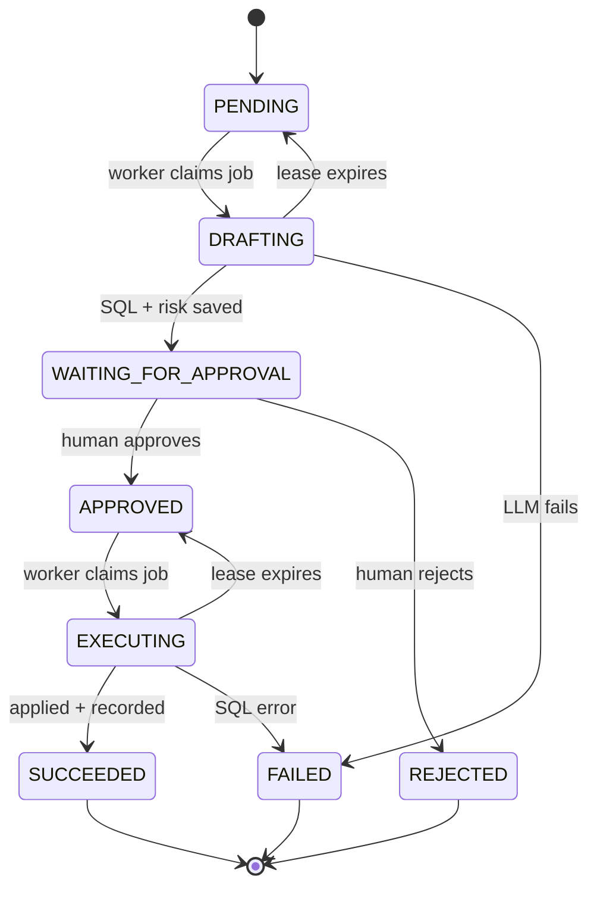

# Relay — Project Plan

Last updated: Oct 9, 2026 · Albert Yorn

## Overview

Relay is a backend service where an AI proposes a database schema change, a human approves it over a REST API, and a pool of workers executes it safely, even if processes crash or two people click approve at once.

**The problem.** Letting an AI agent run `ALTER TABLE` directly is risky, and a script running on one laptop loses everything when it dies. Relay stores every migration as a row in Postgres, so the workflow survives crashes and any teammate can inspect or approve it.

**What it signals:**

- **Backend development:** a FastAPI service with a clear REST design, typed request and response models, and a Postgres schema you designed.
- **Distributed systems:** multiple workers competing for jobs, leases that recover work from crashed workers, idempotent retries, and race-free state transitions.
- **What 2027 intern recruiters look for:** Docker, real tests (including concurrency tests), sensible use of an LLM as one component rather than the whole product, and a design you can defend line by line.

**One-line pitch:** "A Postgres-backed job system that gates AI-generated schema migrations behind human approval, with tests proving it survives worker crashes and concurrent approvals."

## Scope decisions

Every tool here is new to me, so v1 drops LangGraph and builds the workflow directly on Postgres. That is less to learn, and every reliability guarantee becomes code I wrote and can explain.

| Decision | Choice for v1 | Why |
| --- | --- | --- |
| Workflow engine | My own state machine: a `migrations` table with a `status` column | LangGraph's checkpointer would hide the durability story. A status column plus conditional updates is easy to learn and easy to defend. |
| Job queue | Postgres itself, using `SELECT ... FOR UPDATE SKIP LOCKED` | One database instead of adding Redis or Kafka. This is a real production pattern. |
| Workers | A separate `worker` service, run as 2+ copies in Docker Compose | Several processes competing for the same jobs is what makes this a distributed-systems project. |
| Crash recovery | Leases with an ownership token: each claim gets a fresh `lease_token`; expired jobs get reclaimed | A lease recovers work from dead workers; the token stops a paused worker from changing Relay's state after it lost the job; the target marker protects the migration itself. |
| Target database | A second, disposable Postgres database (`target_db`) seeded with demo tables; migrations run as a non-superuser role that owns only those tables | Keeps Relay's state separate from the database being changed, and limits damage from a bad statement. |
| Execution safety | Marker row inserted first, then the DDL, in one target transaction with `lock_timeout` and `statement_timeout` | Postgres DDL is transactional, so a failed or duplicate run leaves no half-applied change. |
| SQL policy | One statement only, parsed with a real Postgres parser; only allow-listed operations run (start with `ADD COLUMN` on demo tables); anything else is rejected | Approval establishes intent, not safety. Code enforces what's allowed; the LLM never decides. |
| LLM | A fake LLM through Week 3; the Groq adapter comes in Week 4 | The workflow is the hard part. Building against a predictable fake keeps tests fast and debugging simple. |
| Database access | psycopg 3, synchronous, plain SQL. No ORM. | Every transaction boundary is visible in my own code. FastAPI runs plain `def` endpoints in a threadpool. |
| Auth | No real auth. Callers send an `X-User` header, recorded in the audit log | It's an untrusted label, not security. Say this plainly if asked. |
| Environment | Everything (API, workers, tests) runs in Docker Linux containers from one pinned Python image | I develop on a Windows 11 ARM64 laptop and a Windows 11 x64 PC. Containers make both machines and CI identical. |
| Deployment | Local Docker Compose; all config from environment variables | Deploying later means changing env vars, not code. |

**Phase 2** (Week 4): the real Groq adapter, GitHub Actions CI, structured logs with migration and worker IDs, a retry limit, Phase 2 tests, and a crash GIF.

**Cut entirely for now:** LangGraph, real authentication, cloud deployment, local inference via Ollama, a frontend, metrics dashboards, schema-drift detection, SQL editing during review.

## Architecture

The API and the workers never talk to each other directly. Postgres is the only channel between them, so either side can crash and restart without losing work.

In Docker Compose this is: `api`, `worker` (scaled to 2 or more copies), one `postgres` container holding both `relay_db` and `target_db`, and a `tests` service for running pytest. The LLM is the only outside dependency.

## Development environment

- **Two machines:** Windows 11 ARM64 laptop and Windows 11 x64 PC. Nothing depends on host Python; a local venv is optional and only for editor autocomplete.
- **One pinned image** (e.g. `python:3.13-slim`) and exact versions in `requirements.txt`, so both machines and CI install the same thing.
- **Tests run in a container:** `docker compose run --rm tests pytest`.
- **Git is the only sync method.** Push at the end of every session, pull at the start. Never sync the folder through OneDrive.
- **Line endings:** `.gitattributes` with `* text=auto eol=lf`, so scripts and SQL files don't break inside Linux containers.
- **`.env` is per machine.** Create it by hand from `.env.example` on each machine.
- **Database data is per machine and disposable.** The schema lives in SQL files in the repo, so both machines rebuild it identically.

## State machine and data model

A migration is one row whose `status` column moves through eight values. Workers act on `PENDING` and `APPROVED` rows; only a human can move a row out of `WAITING_FOR_APPROVAL`.

The "lease expires" edges are crash recovery: if a worker dies while a job is `DRAFTING` or `EXECUTING`, its lease expires and the job goes back to be claimed again. Recovery does not mean the earlier attempt is known to have failed; for execution, the next worker checks `relay_applied` first.

**The one rule:** every transition is a single `UPDATE ... WHERE id = $1 AND status = '<expected state>'` (plus the lease-token check when a worker acts) and an insert into `migration_events`, in one transaction. If 0 rows update, someone else got there first.

| Table | Key columns | Purpose |
| --- | --- | --- |
| `migrations` (relay_db) | id (UUID), description, status, proposed_sql, proposed_sql_hash, approved_sql_hash, risk_level, risk_reason, lease_token, lease_expires_at, attempts, error, created_at, updated_at | One row per migration; `status` is the workflow state, the lease columns say who owns the current attempt |
| `migration_events` (relay_db) | migration_id, from_status, to_status, actor, created_at | Append-only audit log of every transition, indexed by migration_id |
| `idempotency_keys` (relay_db) | endpoint, key, request_hash, status_code, response_body, created_at | Unique on (endpoint, key); saved responses so retries return the same answer |
| `relay_applied` (target_db) | migration_id (primary key), sql_hash, applied_at | Proof a migration ran; inserted before its SQL in the same transaction |

A `CHECK` constraint restricts `status` to the eight valid values.

## API endpoints

The API never does slow work itself: it writes rows, and workers pick them up.

| Method + path | What it does | Key behavior |
| --- | --- | --- |
| `POST /migrations` | Create a migration request from a plain-English description | Returns `202 Accepted` with the migration id; status starts as `PENDING`. Idempotency key added in Phase 2. |
| `GET /migrations/{id}` | Show status, generated SQL, its hash, risk level, and recent events | Read-only; safe to call any number of times. |
| `GET /migrations` | List migrations, filterable by status | Lets reviewers see what's waiting for approval. |
| `POST /migrations/{id}/approve` | Approve the proposal exactly as generated | Requires `Idempotency-Key` and the SQL hash the reviewer saw. Only succeeds from `WAITING_FOR_APPROVAL`; otherwise `409`. A stale hash also gets `409`. |
| `POST /migrations/{id}/reject` | Reject with a reason | Same rules as approve. |
| `GET /health` | Liveness and database check | Used by Docker and any future host to know the service is alive. |

Status codes: `200` completed, `202` accepted for async work, `404` unknown id, `409` state or hash conflict, `422` malformed input or policy violation, `500` unexpected (no stack traces returned to clients).

## Correctness features

Five mechanisms carry the project. Each one answers a specific "what if" an interviewer will ask, and each has a test that proves it.

**1. Race-free transitions (what if two people approve at once?)**
One helper function is the only way a status changes. In one Relay transaction it runs `UPDATE migrations SET status = <new> WHERE id = $1 AND status = <expected>` (plus `AND lease_token = <mine>` when a worker is acting), inserts one `migration_events` row, and commits both or neither. If 0 rows update, someone else got there first, and the API returns `409 Conflict`. This is a compare-and-set; I'll also learn `SELECT ... FOR UPDATE` and when to pick each.

**2. Approval bound to the exact SQL (what if the SQL changes after approval?)**
Each proposal stores a hash of its SQL. The approve request must include the hash the reviewer saw; a mismatch returns `409`. In v1 there is no editing: a reviewer approves the generated SQL as-is or rejects it with a reason. Before executing, the worker re-checks that the SQL's hash still matches the approved hash. Approval means "a human chose this exact statement," not "this statement is safe," which is why the SQL policy still applies.

**3. Job claiming with leases and ownership tokens (what if a worker dies, or freezes and wakes up late?)**
A worker claims one job with a short transaction (`UPDATE ... WHERE id = (SELECT ... FOR UPDATE SKIP LOCKED LIMIT 1) RETURNING ...`) that sets a fresh random `lease_token` and `lease_expires_at`, then **commits before calling the LLM or touching the target**. Never hold a transaction open across slow work. If the worker dies, the lease expires and another worker reclaims the job with a new token. If the first worker was only paused and wakes up, every write it attempts includes `AND lease_token = <its old token>`, matches 0 rows, and it stops. The token stops stale workers from changing Relay's state. It can't stop them from touching other systems, which is why the target protects itself (mechanism 4). This is an ownership token, not a full fencing token, which would be an increasing number checked by the protected resource itself. Delivery is at-least-once.

**4. Safe execution across two databases (what if it fails, or runs twice?)**
No transaction spans both databases, so the target protects itself. In one target transaction the worker:

1. Sets `lock_timeout` (max wait for locks) and `statement_timeout` (max total run time).
2. Runs `INSERT INTO relay_applied (migration_id, sql_hash) ... ON CONFLICT DO NOTHING RETURNING migration_id` *first*.
3. Runs the DDL only if that insert returned a row.
4. If a marker already exists, checks that its `sql_hash` matches the approved hash: a match means skip, a mismatch means mark `FAILED` and stop.
5. Commits.

A concurrent worker's insert waits on the primary key until the first transaction finishes, then either skips (it committed) or proceeds (it rolled back). After committing, the worker marks `SUCCEEDED` in Relay with its token check. If it crashes in between, the next worker finds the marker and just marks it done. The target is a disposable demo database, and migrations run as a non-superuser role that owns only the demo tables. Postgres has no "may alter this table" grant; ownership is what allows `ALTER TABLE`.

**5. Idempotency keys (what if the client retries after a timeout?)**
`idempotency_keys` has a unique constraint on `(endpoint, key)`. The key row is inserted in the same transaction as the real change, so two identical requests arriving together can't both act: the second blocks on the unique index, then reads the winner's saved response. Each key also stores a hash of the request body; reusing a key with a different body returns `422`. Locking (1) stops two *different* requests from conflicting; idempotency stops the *same* request from counting twice.

**What Relay does *not* guarantee:** exactly-once delivery (it's at-least-once delivery with once-only effects on the target), atomic commits across the two databases, protection against SQL that is allowed by the policy but still wrong, safety for SQL outside the allow-list, or any security: `X-User` is an untrusted label for the audit log, not authentication.

## Concurrency and crash test plan

Each test proves one guarantee above, runs against a real Postgres in Docker (not mocks), and uses the fake LLM so results are repeatable. Assertions check database rows and audit events, not just HTTP responses.

| Test | How it works | Passes when |
| --- | --- | --- |
| Concurrent approval | Fire 20 approve requests at one migration at once, each with a *different* idempotency key | Exactly 1 succeeds, 19 get `409`, and there is exactly one approval event |
| Worker contention (generation) | Create 50 jobs, run 4 workers at once | All 50 reach `WAITING_FOR_APPROVAL`, and no two workers ever hold valid leases on one job. Count claims separately: retries can mean more claims than jobs. |
| Worker contention (execution) | Approve 50 jobs, run 4 workers at once | All 50 reach `SUCCEEDED` with exactly one `relay_applied` marker each |
| Stale worker | Worker A's lease is expired and reclaimed by B; A then tries to finish | A's writes match 0 rows; Relay state reflects only B |
| Crash during generation | Use a short test lease (e.g. 2 seconds); kill the worker after it claims | Another worker reclaims the job and it reaches `WAITING_FOR_APPROVAL` |
| Crash after target commit | Commit on the target, then kill the worker before it marks success | The next worker finds a marker with a matching hash, skips the DDL, and marks `SUCCEEDED` |
| Failed DDL | Submit allowed SQL that errors on the target | Target schema unchanged, no marker row, status `FAILED` with the error saved |
| Duplicate idempotency key | Send two identical approve requests at once with the *same* key; then reuse the key with a different body | One mutation, identical responses; the different body gets `422` |

**Phase 2 tests:** a stale SQL hash can't be approved or executed; a migration blocked by another transaction hits `lock_timeout`; terminal states reject every transition; a repeatedly failing job stops at its retry limit.

**Timing rules:**
- Never `sleep` past a real lease. Configure short leases in tests, or pass the clock in.
- Force each race on purpose with barriers or events so both sides reach the critical moment together.
- Only after a test reliably creates its race, repeat it (e.g. `pytest --count=20` with `pytest-repeat`) to catch rare interleavings.

**`demo_crash.py`** shows the most interesting failure: it approves a migration, waits until the worker commits on the target, kills that worker before it marks success, and prints a second worker finding the marker and finishing the job. A test hook (e.g. an environment variable that makes the worker pause right after the target commit) makes the kill land at exactly that moment instead of depending on timing luck.

## 30-day roadmap

About 30 hours at an hour a day: the core (all five mechanisms, built against the fake LLM) in Weeks 1–3, then Phase 2 and the write-up in Week 4. Each week's gate is the milestone; if a week runs long, finish its gate before moving on.

**Each 1-hour session:**
1. *Predict:* write the invariant in one sentence, e.g. "two workers can never claim the same row."
2. *Specify:* write or ask for the test first.
3. *Implement:* have Claude Code make one small change that passes it, and read the whole diff.
4. *Explain:* one entry in `LEARNING.md`, including one way it could fail.

If I can't explain a diff, I don't keep it.

**Week 1: Durable API** (gate: create a migration, restart every container, and read the same record back)

- [ ] Day 1: Repo setup (`.gitignore`, `.gitattributes`, `CLAUDE.md`, `LEARNING.md`); Docker Compose with Postgres; connect with `psql` and look around
- [ ] Day 2: SQL by hand: tables, constraints, `BEGIN` / `COMMIT` / `ROLLBACK`
- [ ] Day 3: Dockerfile for the API; FastAPI and Pydantic basics; `GET /health`
- [ ] Day 4: `migrations` and `migration_events` tables; create and get endpoints
- [ ] Day 5: The transition helper, the only way a status changes
- [ ] Day 6–7: First integration tests against real Postgres in the `tests` container; 404, 409, and 422 errors

**Week 2: Workers and approval** (gate: of 20 concurrent approvals exactly one wins, and no worker holds a transaction during slow work)

- [ ] Day 8: Write the "two workers, one row" test first
- [ ] Day 9–10: Claim with `SKIP LOCKED` and a fresh `lease_token`; commit before doing work
- [ ] Day 11: Fake LLM interface; SQL policy using a Postgres parser
- [ ] Day 12: Approve and reject endpoints, bound to the SQL hash
- [ ] Day 13–14: Concurrent approval test and worker contention tests

**Week 3: Safe execution, recovery, and idempotency** (gate: the crash-after-commit and duplicate-key tests pass; the core is done)

- [ ] Day 15: `target_db` with seeded demo tables and a least-privilege role
- [ ] Day 16: Marker-first execution with both timeouts; failed-DDL test
- [ ] Day 17–18: Lease expiry, reclaim, and token checks; stale-worker and crash-during-generation tests
- [ ] Day 19: Crash-after-commit test
- [ ] Day 20–21: Idempotency keys on approve and reject; duplicate-key test

**Week 4: Phase 2 and proof** (gate: a fresh clone runs the tests and the demo with documented commands, and CI is green)

- [ ] Day 22: Groq adapter behind the same LLM interface (tests keep using the fake)
- [ ] Day 23: Structured logs with migration ID, worker ID, and attempt; retry limit
- [ ] Day 24: GitHub Actions running the real-Postgres tests on every push
- [ ] Day 25: Phase 2 tests: stale SQL hash, `lock_timeout`, terminal states, retry limit
- [ ] Day 26: `demo_crash.py` and a short recorded GIF
- [ ] Day 27–28: README: architecture, guarantees, non-guarantees, setup
- [ ] Day 29–30: Buffer, then explain the concepts below out loud without notes

**Never cut** the real-Postgres concurrency tests or the crash-after-commit test; they are the project's evidence. If I fall behind, drop Week 4 items in this order: the GIF, the Phase 2 tests, structured logs. Keep the README and CI.

## Concepts to explain cold

By day 30 I should be able to answer each of these out loud in under two minutes, with an example from Relay.

**Backend**

- [ ] Why the API returns `202 Accepted` and hands work to a worker instead of doing it in the request
- [ ] What `async` buys you in FastAPI, when it doesn't help, and why Relay uses sync psycopg
- [ ] What a database transaction guarantees (ACID), in plain words
- [ ] Why each status change is also written to an audit table, in the same transaction
- [ ] Status codes Relay uses: 200, 202, 404, 409, 422, and why 409 for an illegal transition

**Distributed systems**

- [ ] How `SKIP LOCKED` lets many workers share one queue without double-claiming, and what it does *not* guarantee
- [ ] Leases: why a lock with an expiry beats one held forever, and what goes wrong if it's too short
- [ ] Ownership tokens vs. true fencing tokens: what Relay's token stops a stale worker from doing, and what it doesn't
- [ ] Why you commit the claim before calling the LLM or touching the target
- [ ] At-least-once delivery vs. once-only effects: how Relay gets the second from the first
- [ ] Why no transaction can span two databases, and why the `relay_applied` marker is inserted *before* the DDL
- [ ] How Relay reconciles a target commit followed by a worker crash
- [ ] Idempotency vs. mutual exclusion vs. deduplication: which problem each solves in Relay
- [ ] Compare-and-set vs. `SELECT ... FOR UPDATE`: when to use each

**Design judgment**

- [ ] Why Postgres as a queue instead of Redis or Kafka, and when you'd switch
- [ ] Why human approval is not the same as SQL validation
- [ ] `lock_timeout` vs. `statement_timeout`
- [ ] Safety vs. liveness, using Relay's tests as examples
- [ ] Which failures retry automatically and which need a human
- [ ] What Relay doesn't protect against, and what you'd add next

## Working rules

The goal of each session is understanding first and code second. A day where I understand one thing deeply and ship little is a good day; a day where Claude Code ships a lot that I can't explain is a bad one.

### The five invariants

1. Every status change goes through the transition helper. Nothing else writes `status`.
2. Never hold a transaction or row lock across an LLM call or any slow work. Claim, commit, then work.
3. Every worker write to Relay that depends on its claim is conditional on the current `lease_token` and expected status, and commits atomically with its audit event. (Plain logging doesn't need the token.)
4. On the target, insert the `relay_applied` marker before the DDL, in the same transaction. An existing marker counts as success only if its `sql_hash` matches.
5. Never claim a guarantee in the README that a test doesn't prove.

### Working with Claude Code

- **Ask for the plan before the code.** "How would you implement X? Where are the transaction boundaries? What could go wrong?" Push back, then say go. Use plan mode for anything touching transactions or locks.
- **One small change per request.** If a diff doesn't fit on a couple of screens, ask for it in pieces.
- **Read every diff.** For each function, I should be able to say what it does and why it's there.
- **No new dependencies without a reason.** Ask what it does and what the no-library alternative would be.
- **Ask for causes, not fixes.** When something breaks, ask "why is this happening?" first.
- **Write the critical code myself:** the transition helper, the claim query, the target marker transaction, and the idempotency reservation. For each, know its precondition, its atomic operation, how it fails, and the invariant it protects.

### Learning the concepts

- **Try it in `psql` before writing code.** Open two terminals, run `BEGIN; SELECT ... FOR UPDATE;` in one and the same query in the other. Watch it wait. Then try `SKIP LOCKED`.
- **Predict before running.** Write down what I expect; when I'm wrong, that's the thing to note.
- **Break it on purpose.** Once a test passes, remove its guard (drop `AND status = ...`, remove `SKIP LOCKED`), or on a throwaway database run the DDL in its own transaction and simulate a crash before the marker insert. Watch the test fail, then put it back.
- **Explain it back.** At the end of a session, explain what I built to Claude and ask what I got wrong or left out.

### Session habits

- **Start** (5 min): `git pull`; reread yesterday's `LEARNING.md` entry and today's checklist item; write today's invariant in one sentence.
- **End** (5 min): tests pass or I've noted exactly where I stopped; commit with a message I write that says why; `git push`.
- **Stuck for 20 minutes?** Read the full error from the bottom up, check `docker compose logs`, then ask Claude to explain the cause.
- **At each weekly gate:** explain that week's concepts out loud without notes, write that part of the README from memory, and `git tag week-N`.

### Repo hygiene

- Secrets live in `.env` (gitignored); commit `.env.example` with fake values. Never commit the Groq key.
- Tests reset the database between runs, so results never depend on leftovers.
- `CLAUDE.md` holds working rules for Claude Code; this file holds what to build; `LEARNING.md` holds my notes.